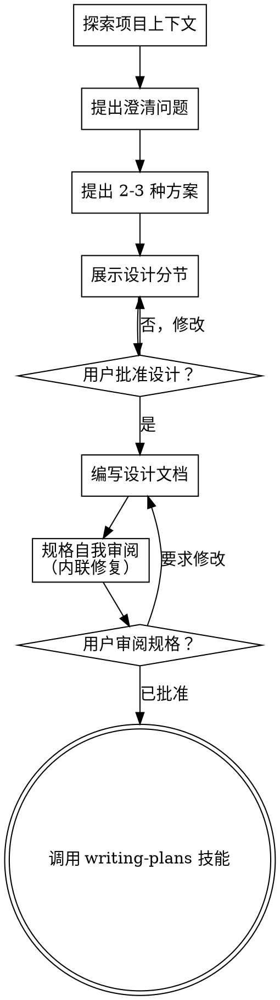

# 将想法头脑风暴为设计方案

通过自然的协作对话，帮助将想法转化为完整的设计和规格说明。

从理解当前项目上下文开始，然后一次只问一个问题来完善想法。一旦你理解了要构建什么，展示设计方案并获取用户批准。

<HARD-GATE>
在展示设计方案并获得用户批准之前，**禁止**调用任何实现技能、编写任何代码、搭建任何项目框架，或采取任何实现行动。无论项目看起来多简单，这一规则适用于**每个**项目。
</HARD-GATE>

## 反模式："这太简单，不需要设计"

每个项目都要经过这个流程。待办事项列表、单函数工具、配置变更——全部包括。"简单"项目中未经审视的假设是造成最多浪费工作的原因。设计可以很短（对于真正简单的项目，几句话即可），但你必须展示它并获取批准。

## 检查清单

你必须为以下每一项创建任务，并按顺序完成：

1. **探索项目上下文** — 检查文件、文档、最近的提交
2. **适时提供可视化助手** — 不是一开始就提供。当某个问题确实用展示比描述更清晰时，才在那一刻提供（单独的一条消息）；用户同意后浏览器标签页会为你打开。如果始终没有需要可视化的问题，就永远不要提供。详见下方可视化助手章节。
3. **提出澄清问题** — 一次一个，理解目的/约束/成功标准
4. **提出 2-3 种方案** — 附带权衡分析和你的推荐
5. **展示设计** — 按复杂度分节展示，每节获取用户批准
6. **编写设计文档** — 保存到 `docs/superpowers/specs/YYYY-MM-DD-<主题>-design.md` 并提交
7. **规格自我审阅** — 快速内联检查占位符、矛盾、歧义、范围（见下方）
8. **用户审阅书面规格** — 在继续之前，请用户审阅规格文件
9. **过渡到实现** — 调用 writing-plans 技能创建实现计划

## 流程

**终态是调用 writing-plans。** 不要调用 frontend-design、mcp-builder 或任何其他实现技能。头脑风暴之后你唯一调用的技能是 writing-plans。

## 流程细节

**理解想法：**

- 首先了解当前项目状态（文件、文档、最近的提交）
- 在询问详细问题之前，评估范围：如果请求描述了多个独立的子系统（例如 "构建一个包含聊天、文件存储、计费和分析的平台"），立即指出。不要在需要先分解的项目细节上浪费提问。
- 如果项目太大，无法放入单个规格，帮助用户将其分解为子项目：独立的部分有哪些，它们之间如何关联，应该按什么顺序构建？然后对第一个子项目按常规设计流程进行头脑风暴。每个子项目走独立的 规格 → 计划 → 实现 循环。
- 对于范围合适的项目，一次只问一个问题来完善想法
- 尽可能优先使用选择题，但开放式问题也可以
- 每条消息只问一个问题——如果某个主题需要更多探索，拆分成多个问题
- 关注理解：目的、约束、成功标准

**探索方案：**

- 提出 2-3 种不同的方案，附带权衡分析
- 以对话方式展示选项，包含你的推荐和理由
- 先展示你推荐的选项，并解释原因

**展示设计：**

- 一旦你相信自己理解了要构建什么，就展示设计
- 根据复杂度调整每节的篇幅：简单则几句话，复杂可到 200-300 字
- 每节之后询问目前设计是否看起来正确
- 涵盖：架构、组件、数据流、错误处理、测试
- 如果某个点不清楚，随时准备回头澄清

**为隔离性和清晰性而设计：**

- 将系统拆分为更小的单元，每个单元有单一明确的目的，通过定义良好的接口通信，能够被独立理解和测试
- 对于每个单元，你应该能回答：它做什么，如何使用它，它依赖什么？
- 不用阅读内部实现就能理解一个单元做什么吗？修改内部实现不会破坏消费者吗？如果不能，边界需要改进。
- 更小、边界清晰的单元也更容易处理——你对能一次性放在上下文中的代码推理得更好，当文件聚焦时你的编辑也更可靠。当文件变大时，通常意味着它做了太多事情。

**在现有代码库中工作：**

- 在提出变更之前探索当前结构。遵循现有模式。
- 如果现有代码存在影响工作的问题（例如，文件过大、边界不清、职责纠缠），将有针对性的改进纳入设计中——就像一个优秀开发者在他们工作的代码中做的那样。
- 不要提出无关的重构。专注于服务当前目标。

## 设计之后

**文档化：**

- 将验证过的设计（规格）写入 `docs/superpowers/specs/YYYY-MM-DD-<主题>-design.md`
  - （用户对规格位置的偏好覆盖此默认值）
- 如果可用，使用 elements-of-style:writing-clearly-and-concisely 技能
- 将设计文档提交到 git

**规格自我审阅：**
写完规格文档后，用全新的眼光审视它：

1. **占位符扫描：** 有没有 "TBD"、"TODO"、不完整的部分或模糊的需求？修复它们。
2. **内部一致性：** 各节之间是否矛盾？架构是否与功能描述匹配？
3. **范围检查：** 是否足够聚焦，适合单个实现计划，还是需要分解？
4. **歧义检查：** 有没有需求可以被理解为两种不同的意思？如果有，选一种并明确化。

内联修复任何问题。无需重新审阅——修复后继续即可。

**用户审阅关口：**
规格审阅循环通过后，在继续之前请用户审阅书面规格：

> "规格已写入并提交到 `<路径>`。请审阅，如果在我开始编写实现计划之前需要任何修改，请告诉我。"

等待用户的回复。如果他们要求修改，进行修改并重新运行规格审阅循环。只有用户批准后才继续。

**实现：**

- 调用 writing-plans 技能创建详细的实现计划
- 不要调用任何其他技能。writing-plans 是下一步。

## 关键原则

- **一次一个问题** — 不要用多个问题压垮用户
- **优先选择题** — 可能的话，比开放式问题更容易回答
- **无情贯彻 YAGNI** — 从所有设计中移除不必要的功能
- **探索替代方案** — 在确定之前始终提出 2-3 种方案
- **增量验证** — 展示设计，获取批准，然后继续
- **保持灵活** — 当某个点不清楚时，回头澄清

## 可视化助手

一个基于浏览器的辅助工具，用于在头脑风暴中展示模型、图表和可视化选项。作为工具使用——而非某种模式。接受助手意味着它可用于那些受益于可视化处理的问题；并不意味着每个问题都通过浏览器。

**提供助手（适时）：** 不要一开始就提供。等到某个问题确实用展示比用文字描述更清晰时——一个真实的模型/布局/图表问题，而不仅仅是一个 UI 主题。第一次出现这种情况时，在那一刻提供，作为一条独立消息：
> "接下来的部分如果我用展示的方式可能会更简单——我可以在浏览器标签页中同步展示模型、图表和对比。这个功能还比较新，可能会消耗较多 token。需要吗？我帮你打开。"

**这个提供必须是独立的一条消息。** 只有这个提议——不要附带澄清问题、总结或其他内容。等待用户的回复。如果他们接受，用 `--open` 启动服务器，这样他们的浏览器会自动打开到第一个页面。如果他们拒绝，继续纯文本模式，除非用户主动提起，否则不要再提供。

**每个问题的决策：** 即使用户接受了，也要为每个问题决定使用浏览器还是终端。测试标准是：**用户通过看来理解问题，比通过读来理解更好吗？**

- **使用浏览器** 处理视觉性强的内容——模型、线框图、布局对比、架构图、并排视觉设计
- **使用终端** 处理文本性内容——需求问题、概念选择、权衡列表、A/B/C/D 文本选项、范围决策

关于 UI 主题的问题并不自动等于可视化问题。"在这个上下文中，'个性'是什么意思？" 是概念性问题——用终端。"哪种向导布局更好？" 是可视化问题——用浏览器。

如果他们同意使用助手，在继续之前阅读详细指南：
`skills/brainstorming/visual-companion.md`
