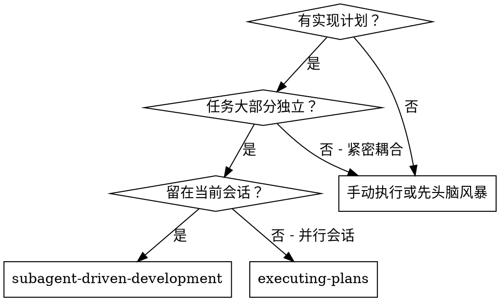
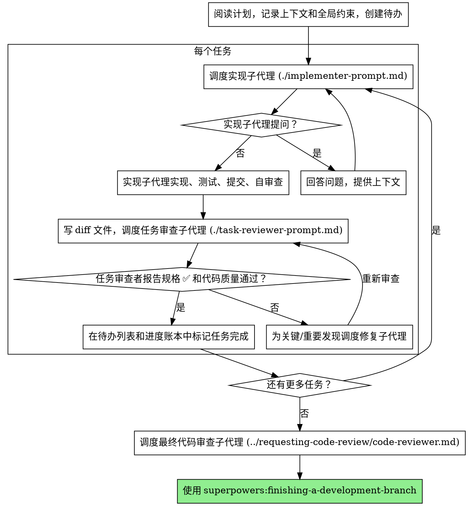

# 子代理驱动开发

通过为每个任务调度一个全新的实现子代理、每个任务后进行任务审查（规格合规 + 代码质量），以及最后的全分支审查来执行计划。

**为什么用子代理：** 你将任务委派给具有隔离上下文的专门代理。通过精确构建它们的指令和上下文，确保它们保持专注并成功完成任务。它们绝不应继承你会话的上下文或历史——你只构建它们所需的内容。这也为你自己的协调工作保留了上下文。

**核心原则：** 每个任务全新子代理 + 任务审查（规格 + 质量）+ 全分支最终审查 = 高质量、快速迭代

**叙述：** 在工具调用之间，最多叙述一行简短的内容——账本和工具结果承载记录。

**持续执行：** 不要在任务之间暂停来与你的用户确认。执行计划中的所有任务，不要停止。唯一需要停止的理由是：你无法解决的 BLOCKED 状态、真正阻止进展的歧义，或所有任务已完成。"我该继续吗？" 的提示和进度摘要浪费他们的时间——他们让你执行计划，所以执行它。

## 何时使用



**vs. 执行计划（并行会话）：**
- 相同会话（无需上下文切换）
- 每个任务全新子代理（无上下文污染）
- 每个任务后审查（规格合规 + 代码质量），最终全分支审查
- 更快迭代（任务之间无需人工介入）

## 流程



## 飞行前计划审查

在调度任务 1 之前，扫描计划是否有冲突：

- 相互矛盾或与计划的全局约束矛盾的任务
- 计划明确要求但审查评分标准视为缺陷的任何内容（断言为空的测试、逐字复制的逻辑块）

将你发现的所有内容作为一批问题呈现给用户——每个发现旁边注明要求它的计划文本，询问哪个为准——在执行开始前完成，而不是在计划执行中每发现一个就中断一次。如果扫描干净，无需评论继续。审查循环仍然是捕获仅在实现中出现冲突的安全网。

## 模型选择

使用每个角色能处理的性能最低的模型以节省成本和提高速度。

**机械实现任务**（隔离函数、清晰规格、1-2 个文件）：使用快速、便宜的模型。当计划明确规定时，大多数实现任务是机械的。

**集成和判断任务**（多文件协调、模式匹配、调试）：使用标准模型。

**架构和设计任务**：使用最有能力的可用模型。最终全分支审查就是其中之一——在最有能力的可用模型上调度它，而非会话默认值。

**审查任务**：选择具有相同判断力的模型，根据 diff 的大小、复杂性和风险进行扩展。一个小型机械 diff 不需要最有能力的模型；一个微妙的并发变更需要。

**在调度子代理时始终明确指定模型。** 省略模型会继承会话的模型——通常是最有能力也最昂贵的——这会无声地破坏本节。

**轮次数胜过 Token 价格。** 挂钟时间和上下文成本随子代理的轮次数量扩展，而最便宜的模型在多步工作上通常需要 2-3 倍的轮次——总体成本更高。使用中档模型作为审查者和从文本描述工作的实现者的底线。当任务的计划文本包含要编写的完整代码时，实现即转录加测试：对此类实现者使用最便宜档位。单文件机械修复也使用最便宜档位。

**任务复杂度信号（实现任务）：**
- 涉及 1-2 个文件且有完整规格 → 便宜模型
- 涉及多个文件且有集成关注点 → 标准模型
- 需要设计判断或广泛的代码库理解 → 最有能力的模型

## 处理实现者状态

实现子代理报告四种状态之一。适当地处理每种：

**DONE：** 生成审查包（从此技能目录运行 `scripts/review-package BASE HEAD`——它会打印写入的唯一文件路径；BASE 是你在调度实现者之前记录的提交——永远不要用 `HEAD~1`，这会无声地丢弃多提交任务中除了最后一个之外的所有提交），然后使用打印的路径调度任务审查者。

**DONE_WITH_CONCERNS：** 实现者完成了工作但标记了疑虑。在继续之前阅读这些疑虑。如果疑虑涉及正确性或范围，在审查之前解决它们。如果它们是观察（例如，"这个文件变大了"），记录它们并继续审查。

**NEEDS_CONTEXT：** 实现者需要未提供的信息。提供缺失的上下文并重新调度。

**BLOCKED：** 实现者无法完成任务。评估阻碍：
1. 如果是上下文问题，提供更多上下文并用相同模型重新调度
2. 如果任务需要更多推理，用更有能力的模型重新调度
3. 如果任务太大，分解为更小部分
4. 如果计划本身错了，升级到用户

**绝不**忽略升级或强制相同模型在无更改的情况下重试。如果实现者说它卡住了，某些事情需要改变。

## 处理审查者 ⚠️ 项目

任务审查者可能报告 "⚠️ Cannot verify from diff" 项目——存在于未更改代码中或跨任务的需求。这些不会阻塞审查的其余部分，但你必须在标记任务完成之前自己解决每一项：你拥有审查者缺乏的计划和跨任务上下文。如果你确认某项是真正的缺口，将其视为失败的规格审查——将其发回实现者并重新审查。

## 构建审查者提示

每任务审查是任务范围的关口。全分支审查只进行一次，在最终全分支审查时。当你填写审查者模板时：

- 不要添加开放式指令，如 "检查所有使用" 或 "如果对你有用则运行竞态测试"，没有具体的、任务特定的理由
- 不要要求审查者重新运行实现者已经运行过的相同代码上的测试——实现者的报告承载测试证据
- 不要为审查者预先判断发现——永远不要指示审查者忽略或不要标记特定问题。如果你认为一个发现将是误报，让审查者提出并在审查循环中裁定。如果你正在写的提示包含 "不要标记"、"不要将 X 视为缺陷"、"最多 Minor" 或 "计划选择了"——停止：你在预先判断，通常是为了省掉一次审查循环。
- 你交给审查者的全局约束块是它的注意力透镜。从计划的全局约束部分或规格逐字复制具有约束力的需求：确切的值、确切的格式以及组件之间声明的关��（"与 X 相同的布局"、"匹配 Y"）。审查者模板已经承载了流程规则（YAGNI、测试卫生、审查方法）——约束块是关于此项目的规格要求什么。
- 将 diff 作为文件交给审查者：运行此技能的 `scripts/review-package BASE HEAD` 并将它打印的文件路径传递给审查者（或者，没有 bash 时：`git log --oneline`、`git diff --stat` 和 `git diff -U10` 用于范围，重定向到一个唯一命名的文件）。输出永远不会进入你自己的上下文，审查者通过一次 Read 调用看到提交列表、统计摘要和带上下文的完整 diff。使用你调度实现者之前记录的 BASE——永远不用 `HEAD~1`，这会无声地截断多提交任务。
- 一个调度提示描述一个任务，而非会话的历史。不要将累积的前任务摘要（"任务 1-3 后的状态"）粘贴到之后的调度中——一个真实会话的调度达到了 42k 字符，其中 99% 是粘贴的历史。一个全新子代理需要它的任务、它触及的接口以及全局约束。别无其他。
- 为关键和重要发现调度修复子代理。随着进展将次要发现记录在进度账本中，并将最终全分支审查指向该列表，以便它在合并前分类哪些必须修复。没有人读的汇总就是无声的丢弃。
- 标记为计划规定的发现——或与计划文本要求的任何冲突的发现——是用户的决定，如同任何计划矛盾：呈现发现和计划文本，询问哪个为准。不要因为计划规定了它就驳回发现，也不要在不询问的情况下调度与计划矛盾的修复。
- 最终全分支审查也获得一个包：运行 `scripts/review-package MERGE_BASE HEAD`（MERGE_BASE = 分支起始的提交，例如 `git merge-base main HEAD`）并在最终审查调度中包含打印的路径，这样最终审查者读取一个文件而不是用 git 命令重新推导分支 diff。
- 每个修复调度都承载实现者契约：修复子代理重新运行覆盖其变更的测试并报告结果。在调度中命名覆盖的测试文件——一行修复不需要整个套件。在重新调度审查者之前，确认修复报告包含覆盖的测试、运行的命令和输出；一旦三者都存在就调度重新审查。
- 如果最终全分支审查返回发现，调度一个修复子代理并包含完整的发现列表——而非每个发现一个修复者。每个发现一个修复者各自重新构建上下文和重新运行套件；一个真实会话的最终审查修复波的成本超过了所有任务的总和。

## 文件交接

你粘贴到调度提示中的所有内容——以及子代理打印回来的所有内容——在剩余会话中保留在你的上下文中，并在以后的每次轮次中重新读取。将工件作为文件交接：

- **任务简报：** 在调度实现者之前，运行此技能的 `scripts/task-brief PLAN_FILE N`——它将任务的完整文本提取到唯一命名的文件中并打印路径。构建调度使简报保持为需求的单一来源。你的调度应包含：(1) 一行关于此任务在项目中的位置；(2) 简报路径，介绍为 "先读这个——这是你的需求，包含要逐字使用的确切值"；(3) 简报无法知道的来自早期任务的接口和决定；(4) 你对简报中注意到的任何歧义的解决方案；(5) 报告文件路径和报告契约。确切值（数字、魔术字符串、签名、测试用例）仅出现在简报中。
- **报告文件：** 以简报命名实现者的报告文件（简报 `…/task-N-brief.md` → 报告 `…/task-N-report.md`）并将其放在调度提示中。实现者将完整报告写入那里，只返回状态、提交、一行测试摘要和疑虑。
- **审查者输入：** 任务审查者获得三个路径——相同的简报文件、报告文件和审查包——加上绑定任务的全局约束。
- 修复调度将其修复报告（带测试结果）追加到相同的报告文件并返回简短摘要；重新审查读取更新的文件。

## 持久化进度

对话记忆不能在压缩中幸存。在真实会话中，丢失位置的控制器重新调度了整个已完成的任务序列——这是观察到的最昂贵的单次失败。在账本文件中跟踪进度，而不仅仅在待办列表中。

- 在技能启动时，检查账本：`cat "$(git rev-parse --git-path sdd)/progress.md"`。在那里标记为完成的任务就是已完成——不要重新调度它们；从第一个未标记完成的任务恢复。
- 当任务的审查返回干净时，在你的其他簿记同一消息中向账本追加一行：`Task N: complete (commits <base7>..<head7>, review clean)`。
- 账本是你的恢复地图：它命名的提交即使在你的上下文不再记得创建它们时仍存在于 git 中。压缩后，信任账本和 `git log` 超过你自己的记忆。

## 提示模板

- [implementer-prompt.md](implementer-prompt.md) - 调度实现子代理
- [task-reviewer-prompt.md](task-reviewer-prompt.md) - 调度任务审查子代理（规格合规 + 代码质量）
- 最终全分支审查：使用 superpowers:requesting-code-review 的 [code-reviewer.md](../requesting-code-review/code-reviewer.md)

## 示例工作流

```
你：我正在使用子代理驱动开发来执行此计划。

[读取一次计划文件：docs/superpowers/plans/feature-plan.md]
[为所有任务创建待办]

任务 1：Hook 安装脚本

[运行任务 1 的 task-brief；用简报 + 报告路径 + 上下文调度实现者]

实现者："在我开始之前——hook 应该安装在用户级还是系统级？"

你："用户级 (~/.config/superpowers/hooks/)"

实现者："好的。现在实现..."
[稍后] 实现者：
  - 实现了 install-hook 命令
  - 添加了测试，5/5 通过
  - 自审查：发现我漏了 --force 标志，已添加
  - 已提交

[运行 review-package，用打印的路径调度任务审查者]
任务审查者：规格 ✅ - 所有需求满足，没有多余。
  优点：良好的测试覆盖率，干净。问题：无。任务质量：通过。

[标记任务 1 完成]

任务 2：恢复模式

[运行任务 2 的 task-brief；用简报 + 报告路径 + 上下文调度实现者]

实现者：[无问题，继续]
实现者：
  - 添加了 verify/repair 模式
  - 8/8 测试通过
  - 自审查：都好
  - 已提交

[运行 review-package，用打印的路径调度任务审查者]
任务审查者：规格 ❌：
  - 缺失：进度报告（规格说 "每 100 项报告一次"）
  - 多余：添加了 --json 标志（未请求）
  问题（重要）：魔术数字（100）

[用所有发现调度修复子代理]
修复者：移除了 --json 标志，添加了进度报告，提取了 PROGRESS_INTERVAL 常量

[任务审查者再次审查]
任务审查者：规格 ✅。任务质量：通过。

[标记任务 2 完成]

...

[所有任务后]
[调度最终代码审查者]
最终审查者：所有需求满足，可以合并

完成！
```

## 优势

**vs. 手动执行：**
- 子代理自然地遵循 TDD
- 每个任务全新上下文（无混淆）
- 对并行安全（子代理不干扰）
- 子代理可以提问（在工作之前和期间）

**vs. 执行计划：**
- 相同会话（无交接）
- 持续进展（无需等待）
- 审查检查点自动化

**效率收益：**
- 控制器精确策划所需上下文；批量工件作为文件移动，而非粘贴文本
- 子代理预先获得完整信息
- 问题在工作开始前浮现（而非之后）

**质量关口：**
- 自审查在交接前捕获问题
- 任务审查带有两个裁决：规格合规和代码质量
- 审查循环确保修复确实有效
- 规格合规防止过度/不足构建
- 代码质量确保实现良好构建

**成本：**
- 更多子代理调用（每个任务实现者 + 审查者）
- 控制器做更多准备工作（预先提取所有任务）
- 审查循环增加迭代
- 但早期捕获问题（比之后调试更便宜）

## 红旗

**绝不：**
- 未经用户明确同意在 main/master 分支上开始实现
- 跳过任务审查，或接受缺少任一裁决的报告（规格合规和任务质量两者都需要）
- 在未修复问题的情况下继续
- 并行调度多个实现子代理（冲突）
- 让子代理读取整个计划文件（改为交给它任务简报——`scripts/task-brief`）
- 跳过场景设置上下文（子代理需要理解任务的位置）
- 忽略子代理的问题（在让它们继续之前回答）
- 在规格合规上接受 "差不多"（审查者发现规格问题 = 未完成）
- 跳过审��循环（审查者发现问题 = 实现者修复 = 再次审查）
- 让实现者自审查替代实际审查（两者都需要）
- 在调度提示中告诉审查者不要标记什么，或预先评定发现的严重性（"最多视为 Minor"）——计划的示例代码是起点，而非其弱点是被选择了的证据
- 在没有 diff 文件的情况下调度任务审查者——先通过 `scripts/review-package BASE HEAD` 生成它，并在提示中给出打印的路径
- 在审查有未解决的关键/重要问题时移到下一个任务
- 重新调度进度账本已标记为完成的任务——在任何压缩或恢复后检查账本（和 `git log`）

**如果子代理提问：**
- 清晰完整地回答
- 如果需要提供额外上下文
- 不要催促它们进入实现

**如果审查者发现问题：**
- 实现者（相同子代理）修复它们
- 审查者再次审查
- 重复直到通过
- 不要跳过重新审查

**如果子代理任务失败：**
- 用具体指令调度修复子代理
- 不要尝试手动修复（上下文污染）

## 集成

**必需的工作流技能：**
- **superpowers:using-git-worktrees** - 确保隔离的工作空间（创建一个或验证现有的）
- **superpowers:writing-plans** - 创建此技能执行的计划
- **superpowers:requesting-code-review** - 最终全分支审查的代码审查模板
- **superpowers:finishing-a-development-branch** - 所有任务后完成开发

**子代理应使用：**
- **superpowers:test-driven-development** - 子代理为每个任务遵循 TDD

**替代工作流：**
- **superpowers:executing-plans** - 用于并行会话而非相同会话执行
