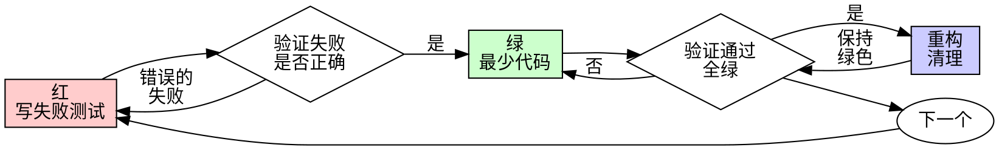

# 测试驱动开发（TDD）

## 概述

先写测试。观察它失败。写最少代码使其通过。

**核心原则：** 如果你没有观察测试失败，你就不知道它是否测试了正确的东西。

**违反规则的文字就是违反规则的精神。**

## 何时使用

**始终：**
- 新功能
- 错误修复
- 重构
- 行为变更

**例外（询问你的用户）：**
- 抛弃式原型
- 生成的代码
- 配置文件

在想 "就这么一次跳过 TDD"？停下。那是在找借口。

## 铁律

```
没有先有失败测试，不写任何生产代码
```

在测试之前写了代码？删掉它。重新开始。

**没有例外：**
- 不要保留它作为 "参考"
- 不要在写测试时 "适应" 它
- 不要看它
- 删除意味着删除

从测试开始全新实现。句号。

## 红-绿-重构



### 红 - 写失败测试

写一个展示应该发生什么的最小测试。

<Good>
```typescript
test('retries failed operations 3 times', async () => {
  let attempts = 0;
  const operation = () => {
    attempts++;
    if (attempts < 3) throw new Error('fail');
    return 'success';
  };

  const result = await retryOperation(operation);

  expect(result).toBe('success');
  expect(attempts).toBe(3);
});
```
清晰的名称，测试真实行为，一件事
</Good>

<Bad>
```typescript
test('retry works', async () => {
  const mock = jest.fn()
    .mockRejectedValueOnce(new Error())
    .mockRejectedValueOnce(new Error())
    .mockResolvedValueOnce('success');
  await retryOperation(mock);
  expect(mock).toHaveBeenCalledTimes(3);
});
```
模糊的名称，测试 mock 而非代码
</Bad>

**要求：**
- 一个行为
- 清晰的名称
- 真实代码（除非不可避免，否则不用 mock）

### 验证红 - 观察它失败

**强制性。绝不跳过。**

```bash
npm test path/to/test.test.ts
```

确认：
- 测试失败（而非错误）
- 失败消息符合预期
- 失败是因为功能缺失（而非拼写错误）

**测试通过了？** 你在测试已有行为。修复测试。

**测试报错了？** 修复错误，重新运行直到它正确失败。

### 绿 - 最少代码

写最简单的代码通过测试。

<Good>
```typescript
async function retryOperation<T>(fn: () => Promise<T>): Promise<T> {
  for (let i = 0; i < 3; i++) {
    try {
      return await fn();
    } catch (e) {
      if (i === 2) throw e;
    }
  }
  throw new Error('unreachable');
}
```
刚好够通过
</Good>

<Bad>
```typescript
async function retryOperation<T>(
  fn: () => Promise<T>,
  options?: {
    maxRetries?: number;
    backoff?: 'linear' | 'exponential';
    onRetry?: (attempt: number) => void;
  }
): Promise<T> {
  // YAGNI
}
```
过度工程化
</Bad>

不要添加功能、重构其他代码或超越测试的 "改进"。

### 验证绿 - 观察它通过

**强制性。**

```bash
npm test path/to/test.test.ts
```

确认：
- 测试通过
- 其他测试仍然通过
- 输出干净（无错误、无警告）

**测试失败？** 修复代码，而非测试。

**其他测试失败？** 现在修复。

### 重构 - 清理

仅在绿色之后：
- 消除重复
- 改进命名
- 提取辅助函数

保持测试绿色。不添加行为。

### 重复

为下一个功能写下一个失败测试。

## 好的测试

| 质量 | 好 | 坏 |
|---------|------|-----|
| **最小** | 一件事。名称中有 "和"？拆分它。 | `test('validates email and domain and whitespace')` |
| **清晰** | 名称描述行为 | `test('test1')` |
| **展示意图** | 展示期望的 API | 模糊代码应该做什么 |

## 为什么顺序重要

**"我之后写测试来验证它工作"**

在代码之后写的测试立即通过。立即通过证明不了什么：
- 可能测试错误的东西
- 可能测试实现而非行为
- 可能遗漏你忘记的边缘情况
- 你从未看到它捕获错误

测试先行迫使你看到测试失败，证明它实际测试了某些东西。

**"我已经手动测试了所有边缘情况"**

手动测试是临时的。你认为你测试了一切，但是：
- 没有你测试了什么的记录
- 代码变更时无法重新运行
- 在压力下容易忘记案例
- "我试的时候它工作了" ≠ 全面的

自动化测试是系统化的。它们每次都相同地运行。

**"删除 X 小时的工作是浪费"**

沉没成本谬误。时间已经没了。你现在选择：
- 用 TDD 删除并重写（X 更多小时，高信心）
- 保留它并在之后添加测试（30 分钟，低信心，可能有错误）

"浪费" 是保留你不能信任的代码。没有真正测试的工作代码是技术债务。

**"TDD 是教条的，务实意味着适应"**

TDD 就是务实的：
- 在提交前发现错误（比之后调试更快）
- 防止回归（测试立即捕获损坏）
- 记录行为（测试展示如何使用代码）
- 支持重构（自由变更，测试捕获损坏）

"务实" 的捷径 = 在生产环境中调试 = 更慢。

**"后写测试实现相同的目标——是精神而非仪式"**

不。后写测试回答 "这做了什么？" 先写测试回答 "这应该做什么？"

后写测试被你的实现所偏见。你测试你构建的东西，而不是需要的东西。你验证你记住的边缘情况，而不是发现的。

先写测试强迫在实现之前发现边缘情况。后写测试验证你记住了所有东西（你没有）。

30 分钟的后写测试 ≠ TDD。你得到了覆盖率，但失去了测试工作的证明。

## 常见借口

| 借口 | 现实 |
|--------|---------|
| "太简单不需要测试" | 简单代码也会坏。测试只需 30 秒。 |
| "我待会测试" | 测试立即通过证明不了什么。 |
| "后写测试实现相同目标" | 后写测试 = "这做了什么？" 先写测试 = "这应该做什么？" |
| "已经手动测试了" | 临时 ≠ 系统化。无记录，无法重新运行。 |
| "删除 X 小时是浪费" | 沉没成本谬误。保留未验证的代码是技术债务。 |
| "保留为参考，先写测试" | 你会适应它。那就是后测试。删除意味着删除。 |
| "需要先探索" | 可以。扔掉探索，从 TDD 开始。 |
| "测试难 = 设计不清晰" | 听从测试。难测试 = 难使用。 |
| "TDD 会拖慢我" | TDD 比调试快。务实 = 先测试。 |
| "手动测试更快" | 手动不证明边缘情况。每次变更你都要重测。 |
| "现有代码没有测试" | 你在改进它。为现有代码添加测试。 |

## 红旗 - 停止并重新开始

- 在测试之前写代码
- 在实现之后测试
- 测试立即通过
- 无法解释测试为什么失败
- 测试是 "稍后" 添加的
- 为 "就这一次" 找借口
- "我已经手动测试了它"
- "后写测试实现相同目的"
- "是关于精神而非仪式"
- "保留为参考" 或 "适应现有代码"
- "已经花了 X 小时，删除是浪费"
- "TDD 是教条的，我是在务实"
- "这次不同是因为..."

**所有这些意味着：删除代码。用 TDD 重新开始。**

## 示例：错误修复

**错误：** 空邮箱被接受

**红**
```typescript
test('rejects empty email', async () => {
  const result = await submitForm({ email: '' });
  expect(result.error).toBe('Email required');
});
```

**验证红**
```bash
$ npm test
FAIL: expected 'Email required', got undefined
```

**绿**
```typescript
function submitForm(data: FormData) {
  if (!data.email?.trim()) {
    return { error: 'Email required' };
  }
  // ...
}
```

**验证绿**
```bash
$ npm test
PASS
```

**重构**
如果需要，为多个字段提取验证。

## 验证检查清单

在标记工作完成之前：

- [ ] 每个新函数/方法都有测试
- [ ] 在实现之前观察了每个测试失败
- [ ] 每个测试因预期原因失败（功能缺失，而非拼写错误）
- [ ] 写了最少代码通过每个测试
- [ ] 所有测试通过
- [ ] 输出干净（无错误、无警告）
- [ ] 测试使用真实代码（仅在不可避免时使用 mock）
- [ ] 覆盖了边缘情况和错误

不能检查所有框？你跳过了 TDD。重新开始。

## 卡住时

| 问题 | 解决方案 |
|---------|----------|
| 不知道如何测试 | 写期望的 API。先写断言。询问你的用户。 |
| 测试太复杂 | 设计太复杂。简化接口。 |
| 必须 mock 一切 | 代码耦合太紧。使用依赖注入。 |
| 测试设置太大 | 提取辅助函数。仍然复杂？简化设计。 |

## 调试集成

发现错误？写重现它的失败测试。遵循 TDD 循环。测试证明修复并防止回归。

绝不在没有测试的情况下修复错误。

## 测试反模式

在添加 mock 或测试工具时，阅读 [testing-anti-patterns.md](testing-anti-patterns.md) 以避免常见陷阱：
- 测试 mock 行为而非真实行为
- 向生产类添加仅测试方法
- 不理解依赖就 mock

## 最终规则

```
生产代码 → 测试存在且先失败
否则 → 不是 TDD
```

没有你用户的许可，没有例外。
