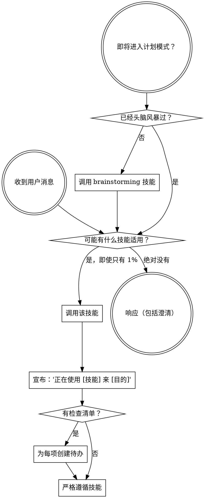

<SUBAGENT-STOP>
如果你被作为子代理调度来执行特定任务，跳过此技能。
</SUBAGENT-STOP>

<EXTREMELY-IMPORTANT>
如果你认为某项技能有哪怕 1% 的几率适用于你正在做的事情，你绝对必须调用它。

如果某项技能适用于你的任务，你别无选择。必须使用它。

这是不可协商的。这不可选。你不能找借口逃脱。
</EXTREMELY-IMPORTANT>

## 指令优先级

Superpowers 技能会覆盖默认的系统提示行为，但 **用户指令始终优先**：

1. **用户的明确指令**（CLAUDE.md、GEMINI.md、AGENTS.md、直接请求）—— 最高优先级
2. **Superpowers 技能** —— 在与系统默认行为冲突时覆盖它们
3. **默认系统提示** —— 最低优先级

如果 CLAUDE.md、GEMINI.md 或 AGENTS.md 说 "不要用 TDD"，而某个技能说 "始终使用 TDD"，请遵循用户的指令。用户掌控一切。

## 如何访问技能

**绝不要用文件工具手动读取技能文件** —— 始终使用你平台的技能加载机制，以便技能被正确激活。

**在 Claude Code 中：** 使用 `Skill` 工具。当你调用技能时，其内容被加载并呈现给你 —— 直接遵循它。

**在 Codex 中：** 技能原生加载。遵循技能激活时呈现的指令。

**在 Copilot CLI 中：** 使用 `skill` 工具。技能从已安装的插件中自动发现。

**在 Gemini CLI 中：** 技能通过 `activate_skill` 工具激活。Gemini 在会话启动时加载技能元数据，并按需激活完整内容。

**在其他环境中：** 查看你平台的文档了解如何加载技能。

## 平台适配

技能使用行动词语（"调度一个子代理"、"创建一个待办"、"读取一个文件"）而非命名任何特定运行时的工具。有关每个平台的工具等价物和指令文件约定，参见 [claude-code-tools.md](references/claude-code-tools.md)、[codex-tools.md](references/codex-tools.md)、[copilot-tools.md](references/copilot-tools.md)、[gemini-tools.md](references/gemini-tools.md)、[pi-tools.md](references/pi-tools.md) 和 [antigravity-tools.md](references/antigravity-tools.md)。Gemini CLI 用户通过 GEMINI.md 自动获得工具映射。

# 使用技能

## 规则

**在任何响应或行动之前调用相关或请求的技能。** 即使有 1% 的几率某项技能可能适用，你也应该调用它来检查。如果调用的技能结果不适合该情况，你不需要使用它。

## 红旗

这些想法意味着停止——你在找借口：

| 想法 | 现实 |
|---------|---------|
| "这只是一个简单的问题" | 问题就是任务。检查技能。 |
| "我需要先了解更多上下文" | 技能检查在澄清问题之前。 |
| "让我先探索代码库" | 技能告诉你如何探索。先检查。 |
| "我可以快速检查 git/文件" | 文件缺乏会话上下文。检查技能。 |
| "让我先收集信息" | 技能告诉你如何收集信息。 |
| "这不需要正式技能" | 如果技能存在，就使用它。 |
| "我记得这个技能" | 技能会演变。阅读当前版本。 |
| "这不算任务" | 行动 = 任务。检查技能。 |
| "这个技能太小题大做了" | 简单的事情会变复杂。使用它。 |
| "我先做这一件事" | 在做任何事之前检查。 |
| "这感觉是高效的" | 无纪律的行动浪费时间。技能防止这一点。 |
| "我知道那是什么意思" | 知道概念 ≠ 使用技能。调用它。 |

## 技能优先级

当多个技能可能适用时，使用此顺序：

1. **先看流程技能**（brainstorming、systematic-debugging）—— 这些决定如何接近任务
2. **再看实现技能**（frontend-design、mcp-builder）—— 这些指导执行

"让我们构建 X" → 先 brainstorming，然后实现技能。
"修复这个错误" → 先 systematic-debugging，然后领域特定技能。

## 技能类型

**严格的**（TDD、systematic-debugging）：严格遵循。不要丢弃纪律。

**灵活的**（模式）：将原则适应于上下文。

技能本身会告诉你它是哪种。

## 用户指令

指令说的是做什么，而非怎么做。"添加 X" 或 "修复 Y" 不意味着跳过工作流。
