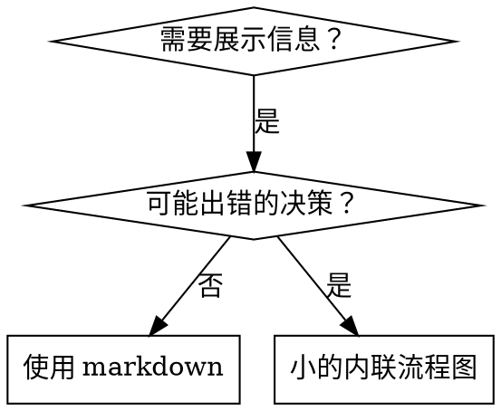

# 编写技能

## 概述

**编写技能就是应用测试驱动开发到过程文档中。**

**个人技能存放在你运行时的技能目录中**——参见 [claude-code-tools.md](../using-superpowers/references/claude-code-tools.md)、[codex-tools.md](../using-superpowers/references/codex-tools.md)、[copilot-tools.md](../using-superpowers/references/copilot-tools.md) 或 [gemini-tools.md](../using-superpowers/references/gemini-tools.md) 获取运行时的路径。Codex、Copilot CLI 和 Gemini CLI 也都将 `~/.agents/skills/` 识别为跨运行时别名。

你编写测试用例（用子代理进行压力场景），观察它们失败（基线行为），编写技能（文档），观察测试通过（代理遵从），并重构（堵塞漏洞）。

**核心原则：** 如果你没有观察代理在没有技能的情况下失败，你就不知道技能是否教会了正确的东西。

**必需的背景：** 在使用此技能之前，你必须理解 superpowers:test-driven-development。该技能定义了基本的红-绿-重构循环。此技能将 TDD 适配到文档中。

**官方指南：** 关于 Anthropic 的官方技能编写最佳实践，参见 anthropic-best-practices.md。此文档提供了补充此技能中 TDD 聚焦方法的额外模式和指南。

## 什么是技能？

**技能**是经过验证的技术、模式或工具的参考指南。技能帮助未来的代理找到并应用有效的方法。

**技能是：** 可重用的技术、模式、工具、参考指南

**技能不是：** 关于你如何曾经解决了一个问题的叙述

## 技能的 TDD 映射

| TDD 概念 | 技能创建 |
|-------------|----------------|
| **测试用例** | 用子代理进行压力场景 |
| **生产代码** | 技能文档 (SKILL.md) |
| **测试失败（红）** | 代理在没有技能的情况下违反规则（基线） |
| **测试通过（绿）** | 代理在有技能的情况下遵从 |
| **重构** | 在保持遵从的同时消除漏洞 |
| **先写测试** | 在写技能之前运行基线场景 |
| **观察它失败** | 记录代理使用的确切借口 |
| **最少代码** | 编写针对那些特定违规的技能 |
| **观察它通过** | 验证代理现在遵从 |
| **重构循环** | 发现新借口 → 堵住 → 重新验证 |

整个技能创建过程遵循红-绿-重构。

## 何时创建技能

**以下情况创建：**
- 技术对你来说不是直觉明显的
- 你会跨项目再次参考它
- 模式广泛适用（非项目特定）
- 其他人会受益

**不要为以下创建：**
- 一次性解决方案
- 其他地方已经充分记录的标准实践
- 项目特定约定（放在你的指令文件中）
- 机械约束（如果可以用正则/验证强制执行，自动化它——文档留给需要判断的情况）

## 技能类型

### 技术
带有遵循步骤的具体方法（condition-based-waiting、root-cause-tracing）

### 模式
关于问题思考方式（flatten-with-flags、test-invariants）

### 参考
API 文档、语法指南、工具文档（office docs）

## 目录结构

```
skills/
  skill-name/
    SKILL.md              # 主要参考（必需）
    supporting-file.*     # 仅在需要时
```

**扁平命名空间** - 所有技能在一个可搜索的命名空间中

**单独文件用于：**
1. **大型参考**（100+ 行）—— API 文档、全面语法
2. **可重用工具** —— 脚本、工具、模板

**保持内联：**
- 原则和概念
- 代码模式（< 50 行）
- 其他一切

## SKILL.md 结构

**前言（YAML）：**
- 两个必需字段：`name` 和 `description`（参见 [agentskills.io/specification](https://agentskills.io/specification) 获取所有支持的字段）
- 总共最多 1024 字符
- `name`：仅使用字母、数字和连字符（无括号、特殊字符）
- `description`：第三人称，仅描述何时使用（而非它做什么）
  - 以 "Use when..." 开头以聚焦触发条件
  - 包含具体症状、情况和上下文
  - **绝不要总结技能的过程或工作流**（参见 SDO 部分了解原因）
  - 尽可能保持在 500 字符以下

```markdown
---
name: Skill-Name-With-Hyphens
description: Use when [特定触发条件和症状]
---

# 技能名称

## 概述
这是什么？1-2 句话的核心原则。

## 何时使用
[如果决策不明显，使用小的内联流程图]

带症状和用例的项目符号列表
何时不使用

## 核心模式（用于技术/模式）
修复前/后代码对比

## 快速参考
扫描常见操作的表格或项目符号

## 实现
简单模式的内联代码
链接到文件用于大型参考或可重用工具

## 常见错误
什么会出错 + 修复

## 真实影响（可选）
具体结果
```

## 技能发现优化（SDO）

**对发现至关重要：** 未来的代理需要找到你的技能

### 1. 丰富的描述字段

**目的：** 你的代理读取描述来决定为给定任务加载哪些技能。让它回答："我现在应该读这个技能吗？"

**格式：** 以 "Use when..." 开头以聚焦触发条件

**关键：描述 = 何时使用，而非技能做什么**

描述应该仅描述触发条件。不要在描述中总结技能的过程或工作流。

**为什么这很重要：** 测试显示当描述总结技能的工作流时，代理可能遵循描述而不是阅读完整技能内容。一个说 "任务之间的代码审查" 的描述导致代理只做了一次审查，即使技能的流程图清楚显示了两阶段审查（规格合规然后代码质量）。

当描述被改为只是 "当使用具有独立任务的实现计划时使用"（无工作流摘要），代理正确读取流程图并遵循了两阶段审查流程。

**陷阱：** 总结工作流的描述创建了代理会采取捷径的机会。技能正文变成了代理跳过的文档。

```yaml
# ❌ 不好：总结工作流——代理可能遵循此而非阅读技能
description: Use when executing plans - dispatches subagent per task with code review between tasks

# ❌ 不好：太多过程细节
description: Use for TDD - write test first, watch it fail, write minimal code, refactor

# ✅ 好：仅有触发条件，无工作流摘要
description: Use when executing implementation plans with independent tasks in the current session

# ✅ 好：仅有触发条件
description: Use when implementing any feature or bugfix, before writing implementation code
```

**内容：**
- 使用具体的触发器、症状和表明此技能适用的情况
- 描述*问题*（竞态条件、不一致行为）而非*语言特定症状*（setTimeout、sleep）
- 保持触发器技术无关，除非技能本身是技术特定的
- 如果技能是技术特定的，在触发器中明确说明
- 用第三人称写（注入到系统提示中）
- **绝不要总结技能的过程或工作流**

```yaml
# ❌ 不好：太抽象、模糊、不包含何时使用
description: For async testing

# ❌ 不好：第一人称
description: I can help you with async tests when they're flaky

# ❌ 不好：提及技术但技能并非特定于它
description: Use when tests use setTimeout/sleep and are flaky

# ✅ 好：以 "Use when" 开头，描述问题，无工作流
description: Use when tests have race conditions, timing dependencies, or pass/fail inconsistently

# ✅ 好：技术特定技能，明确触发器
description: Use when using React Router and handling authentication redirects
```

### 2. 关键词覆盖

使用代理会搜索的词：
- 错误消息："Hook timed out"、"ENOTEMPTY"、"race condition"
- 症状："flaky"、"hanging"、"zombie"、"pollution"
- 同义词："timeout/hang/freeze"、"cleanup/teardown/afterEach"
- 工具：实际命令、库名、文件类型

### 3. 描述性命名

**使用主动语态，动词优先：**
- ✅ `creating-skills` 而非 `skill-creation`
- ✅ `condition-based-waiting` 而非 `async-test-helpers`

### 4. Token 效率（关键）

**问题：** getting-started 和常被引用的技能加载到每次对话。每个 token 都很重要。

**目标字数：**
- getting-started 工作流：每个 <150 词
- 常加载技能：总共 <200 词
- 其他技能：<500 词（仍然要简洁）

**技巧：**

**移动细节到工具帮助：**
```bash
# ❌ 不好：在 SKILL.md 中记录所有标志
search-conversations supports --text, --both, --after DATE, --before DATE, --limit N

# ✅ 好：引用 --help
search-conversations supports multiple modes and filters. Run --help for details.
```

**使用交叉引用：**
```markdown
# ❌ 不好：重复工作流细节
When searching, dispatch subagent with template...
[20 lines of repeated instructions]

# ✅ 好：引用其他技能
Always use subagents (50-100x context savings). REQUIRED: Use [other-skill-name] for workflow.
```

**压缩示例：**
```markdown
# ❌ 不好：冗长的示例（42 词）
your human partner: "How did we handle authentication errors in React Router before?"
You: I'll search past conversations for React Router authentication patterns.
[Dispatch subagent with search query: "React Router authentication error handling 401"]

# ✅ 好：最小示例（20 词）
Partner: "How did we handle auth errors in React Router?"
You: Searching...
[Dispatch subagent → synthesis]
```

**消除冗余：**
- 不要重复交叉引用技能中的内容
- 不要解释从命令中显而易见的内容
- 不要包含同一模式的多个示例

**验证：**
```bash
wc -w skills/path/SKILL.md
# getting-started 工作流：每个目标 <150
# 其他常加载的：总共目标 <200
```

**按你做什么或核心洞见命名：**
- ✅ `condition-based-waiting` > `async-test-helpers`
- ✅ `using-skills` 而非 `skill-usage`
- ✅ `flatten-with-flags` > `data-structure-refactoring`
- ✅ `root-cause-tracing` > `debugging-techniques`

**动名词对过程很好用：**
- `creating-skills`、`testing-skills`、`debugging-with-logs`
- 主动的，描述你正在采取的行动

### 5. 交叉引用其他技能

**当编写引用其他技能的文档时：**

仅使用技能名称，附带明确的要求标记：
- ✅ 好：`**必需的子技能：** 使用 superpowers:test-driven-development`
- ✅ 好：`**必需的背景：** 你必须理解 superpowers:systematic-debugging`
- ❌ 坏：`参见 skills/testing/test-driven-development`（不清楚是否必需）
- ❌ 坏：`@skills/testing/test-driven-development/SKILL.md`（强制加载，消耗上下文）

**为什么不用 @ 链接：** `@` 语法立即强制加载文件，在需要之前消耗 200k+ 上下文。

## 流程图用法



**仅在以下情况使用流程图：**
- 非显而易见的决策点
- 可能过早停止的过程循环
- "何时使用 A vs B" 决策

**绝不将流程图用于：**
- 参考材料 → 表格、列表
- 代码示例 → Markdown 块
- 线性指令 → 编号列表
- 无语义的标签（step1、helper2）

参见此目录中的 `graphviz-conventions.dot` 了解 graphviz 样式规则。

**为你的用户可视化：** 使用此目录中的 `render-graphs.js` 将技能的流程图渲染为 SVG：
```bash
./render-graphs.js ../some-skill           # 每个图表单独渲染
./render-graphs.js ../some-skill --combine # 所有图表在一个 SVG 中
```

## 代码示例

**一个优秀的示例胜过许多平庸的**

选择最相关的语言：
- 测试技术 → TypeScript/JavaScript
- 系统调试 → Shell/Python
- 数据处理 → Python

**好的示例：**
- 完整且可运行
- 良好注释解释为什么
- 来自真实场景
- 清晰展示模式
- 准备适配（非通用模板）

**不要：**
- 用 5+ 种语言实现
- 创建填空模板
- 编写人为示例

你擅长移植——一个优秀的示例就够了。

## 文件组织

### 自包含技能
```
defense-in-depth/
  SKILL.md    # 一切内联
```
当：所有内容适合，不需要大量参考时

### 带可重用工具的技能
```
condition-based-waiting/
  SKILL.md    # 概述 + 模式
  example.ts  # 可适配的工作辅助工具
```
当：工具是可重用代码，不仅仅是叙述时

### 带大量参考的技能
```
pptx/
  SKILL.md       # 概述 + 工作流
  pptxgenjs.md   # 600 行 API 参考
  ooxml.md       # 500 行 XML 结构
  scripts/       # 可执行工具
```
当：参考材料太大不适合内联时

## 铁律（与 TDD 相同）

```
没有先有失败测试，不写任何技能
```

这适用于新技能和对现有技能的编辑。

在测试之前编写技能？删除它。重新开始。
编辑技能而不测试？相同的违规。

**没有例外：**
- 不适用于 "简单的添加"
- 不适用于 "只是添加一个部分"
- 不适用于 "文档更新"
- 不要保留未经测试的变更作为 "参考"
- 不要在运行测试时 "适配"
- 删除意味着删除

**必需的背景：** superpowers:test-driven-development 技能解释了为什么这很重要。相同的原则适用于文档。

## 测试所有技能类型

不同技能类型需要不同的测试方法：

### 纪律执行技能（规则/要求）

**示例：** TDD、verification-before-completion、designing-before-coding

**用以下测试：**
- 学术问题：他们理解规则吗？
- 压力场景：他们在压力下遵从吗？
- 多种压力组合：时间 + 沉没成本 + 疲劳
- 识别借口并添加明确的反对

**成功标准：** 代理在最大压力下遵循规则

### 技术技能（操作指南）

**示例：** condition-based-waiting、root-cause-tracing、defensive-programming

**用以下测试：**
- 应用场景：他们能正确应用技术吗？
- 变体场景：他们能处理边缘情况吗？
- 缺失信息测试：指令有缺口吗？

**成功标准：** 代理成功地将技术应用于新场景

### 模式技能（心智模型）

**示例：** reducing-complexity、information-hiding 概念

**用以下测试：**
- 识别场景：他们能识别模式何时适用吗？
- 应用场景：他们能使用心智模型吗？
- 反例：他们知道何时不应用吗？

**成功标准：** 代理正确识别何时/如何应用模式

### 参考技能（文档/API）

**示例：** API 文档、命令参考、库指南

**用以下测试：**
- 检索场景：他们能找到正确的信息吗？
- 应用场景：他们能正确使用找到的信息吗？
- 缺口测试：常见用例都被覆盖了吗？

**成功标准：** 代理找到并正确应用参考信息

## 跳��测试的常见借口

| 借口 | 现实 |
|--------|---------|
| "技能很明显清晰" | 对你清晰 ≠ 对其他代理清晰。测试它。 |
| "这只是一个参考" | 参考可能有缺口、不清晰的部分。测试检索。 |
| "测试太过分了" | 未测试的技能有问题。总是。15 分钟测试节省数小时。 |
| "如果出现问题我会测试" | 问题 = 代理无法使用技能。在部署前测试。 |
| "测试太乏味了" | 测试比在生产环境中调试坏技能更不乏味。 |
| "我有信心它很好" | 过度自信保证问题。还是测试。 |
| "学术审查就够了" | 阅读 ≠ 使用。测试应用场景。 |
| "没时间测试" | 部署未测试的技能浪费更多时间之后修复它。 |

**所有这些意味着：在部署前测试。没有例外。**

## 使形式匹配失败

在编写指导之前，对基线失败进行分类。对一种失败类型进行加固的形式在另一种上会明显地适得其反。

| 基线失败 | 正确形式 | 错误形式 |
|---|---|---|
| 在压力下跳过/违反规则（心里清楚，仍然这样做） | 禁止 + 借口表 + 红旗（见下方加固） | 软指导（"倾向..."、"考虑..."） |
| 遵从了，但输出形状错误（膨胀的提示、埋没的裁决、重述的规格） | 正面配方或契约：陈述输出是什么——其组成部分，按顺序 | 禁止列表（"不要重述"、"绝不叙述"） |
| 从他们已产生的东西中遗漏了必需元素 | 结构化的：必需的字段或他们填写的模板中的槽位 | 模板附近的文本提醒 |
| 行为应取决于条件 | 基于可观察谓词的条件（"如果简报存在，引用它"） | 无条件规则 + 豁免条款 |

**为什么禁止在塑形问题上适得其反：** 在竞争性激励下（"使提示自包含"），代理与 "不要 X" 协商。在调度提示指导的正面交锋措辞测试中，禁止组产生的非所需内容明显多于配方组（完全分离的分布），并且趋势甚至比无指导对照组更差——对你自己情况做微测试而非假设，但绝对不要默认使用禁止。配方不给代理留下任何可以协商的余地：输出匹配声明的形状，否则就不匹配。

**你选择的无论哪种形式的规则：**
- **没有细微条款。** "不要 X，除非它重要" 重新打开协商——将单个细微条款追加到获胜配方使其在相同措辞测试中从一致降级为噪声。将真正的例外表达为其自己的基于可观察谓词的条件。
- **豁免条款不划定范围。** "此限制不适用于代码块" 仍然抑制代码块。如果部分输出必须豁免，重新结构化使规则无法到达它。

## 加固技能以抵御借口

执行纪律的技能（如 TDD）需要抵御借口。代理很聪明，在压力下会找到漏洞。

**范围：** 这个工具包适用于纪律失败——一个知道规则但在压力下跳过它的代理。对于形状错误的输出或遗漏的元素，基于禁止的加固适得其反；改用"使形式匹配失败"中的形式。

**心理学注释：** 理解为什么说服技术有效有助于你系统地应用它们。参见 persuasion-principles.md 了解权威、承诺、稀缺性、社会认同和统一原则的研究基础（Cialdini，2021；Meincke 等人，2025）。

### 明确堵住每个漏洞

不要只是陈述规则——明确禁止具体的变通方案：

<Bad>
```markdown
在测试之前写代码？删除它。
```
</Bad>

<Good>
```markdown
在测试之前写代码？删除它。重新开始。

**没有例外：**
- 不要保留它作为 "参考"
- 不要在写测试时 "适配" 它
- 不要看它
- 删除意味着删除
```
</Good>

### 应对 "精神 vs 文字" 的论证

早期添加基本原则：

```markdown
**违反规则的文字就是违反规则的精神。**
```

这切掉了整类 "我遵循精神" 的借口。

### 构建借口表

从基线测试中捕获借口（见下方测试部分）。代理提出的每个借口都放进表格：

```markdown
| 借口 | 现实 |
|--------|---------|
| "太简单不需要测试" | 简单代码也会坏。测试只需 30 秒。 |
| "我待会测试" | 测试立即通过证明不了什么。 |
| "后写测试实现相同目标" | 后写测试 = "这做了什么？" 先写测试 = "这应该做什么？" |
```

### 创建红旗列表

让代理在找借口时容易自我检查：

```markdown
## 红旗 - 停止并重新开始

- 在测试之前写代码
- "我已经手动测试了它"
- "后写测试实现相同目的"
- "是关于精神而非仪式"
- "这次不同是因为..."

**所有这些意味着：删除代码。用 TDD 重新开始。**
```

### 为违规症状更新 SDO

添加到描述：你即将违反规则时的症状：

```yaml
description: use when implementing any feature or bugfix, before writing implementation code
```

## 技能的红-绿-重构

遵循 TDD 循环：

### 红：写失败测试（基线）

在没有技能的情况下用子代理运行压力场景。记录确切行为：
- 他们做了什么选择？
- 他们用了什么借口（逐字记录）？
- 哪些压力触发了违规？

这是 "观察测试失败"——在编写技能之前你必须看到代理会自然地做什么。

### 绿：写最少技能

编写针对那些特定借口的技能。不要为假设情况添加额外内容。

用技能运行相同场景。代理现在应该遵从。

### 重构：堵住漏洞

代理找到新借口？添加明确的反驳。重新测试直到无懈可击。

### 在全场景之前微测试措辞

全压力场景运行是最终关口，但每次迭代都又慢又贵。首先用微测试验证措辞本身：

1. **每个调用一个全新上下文样本**——原始 API 调用，或如果你没有 API 访问权限则使用单次子代理。系统提示 = 指导将存在的真实上下文（完整技能或提示模板，而非孤立的指导）；用户消息 = 引诱失败的任务。
2. **始终包含无指导对照。** 如果对照组没有展现实失败，没有什么可修复的——停止，不要编写该指导。
3. **每个变体 5+ 次重复。** 单一样本撒谎。
4. **手动阅读每个标记的匹配。** 如果你想可以程序化评分，但模板回音和引用的反例伪装成命中；仅自动计数过度陈述了失败和成功。
5. **方差是一个指标。** 当指导生效时，各次重复收敛到相同形状。5 次重复中的 5 种不同解释意味着措辞没有约束力——在添加词语之前先收紧形式。

微测试验证措辞；它们不替代纪律技能的压力场景。

**测试方法论：** 参见 [testing-skills-with-subagents.md](testing-skills-with-subagents.md) 获取完整的测试方法论：
- 如何编写压力场景
- 压力类型（时间、沉没成本、权威、疲劳）
- 系统化堵住漏洞
- 元测试技术

## 反模式

### ❌ 叙述性示例
"在会话 2025-10-03 中，我们发现空的 projectDir 导致了..."
**为什么不好：** 太具体，不可重用

### ❌ 多语言稀释
example-js.js、example-py.py、example-go.go
**为什么不好：** 质量一般，维护负担

### ❌ 流程图中的代码
```dot
step1 [label="import fs"];
step2 [label="read file"];
```
**为什么不好：** 无法复制粘贴，难以阅读

### ❌ 泛型标签
helper1、helper2、step3、pattern4
**为什么不好：** 标签应该有语义含义

## 停止：在移到下一个技能之前

**写完任何技能之后，你必须停止并完成部署过程。**

**不要：**
- 批量创建多个技能而不测试每个
- 在当前技能被验证之前移到下一个技能
- 因为 "批处理更高效" 而跳过测试

**下面的部署检查清单对每个技能都是强制性的。**

部署未测试的技能 = 部署未测试的代码。这是对质量标准的违反。

## 技能创建检查清单（TDD 适配）

**重要：为下面的每个检查清单项创建一个待办。**

**红阶段 - 写失败测试：**
- [ ] 创建压力场景（对纪律技能 3+ 组合压力）
- [ ] 在没有技能的情况下运行场景——逐字记录基线行为
- [ ] 识别借口/失败中的模式

**绿阶段 - 写最少技能：**
- [ ] 名称仅使用字母、数字、连字符（无括号/特殊字符）
- [ ] YAML 前言包含必需的 `name` 和 `description` 字段（最多 1024 字符；参见 [规范](https://agentskills.io/specification)）
- [ ] 描述以 "Use when..." 开头，包含具体的触发器/症状
- [ ] 描述用第三人称写
- [ ] 全文关键词用于搜索（错误、症状、工具）
- [ ] 清晰的概述和核心原则
- [ ] 处理在红阶段识别的特定基线失败
- [ ] 指导形式匹配失败类型（见"使形式匹配失败"）
- [ ] 对于行为塑形指导：将措辞与无指导对照进行微测试（5+ 次重复，每个标记的匹配手动阅读）——对纯参考技能不适用
- [ ] 代码内联或链接到单独文件
- [ ] 一个优秀的示例（非多语言）
- [ ] 用技能运行场景——验证代理现在遵从

**重构阶段 - 堵住漏洞：**
- [ ] 识别测试中的新借口
- [ ] 添加明确的反驳（如果是纪律技能）
- [ ] 从所有测试迭代构建借口表
- [ ] 创建红旗列表
- [ ] 重新测试直到无懈可击

**质量检查：**
- [ ] 小的流程图仅在决策不明显时使用
- [ ] 快速参考表
- [ ] 常见错误部分
- [ ] 没有叙述性故事
- [ ] 支持文件仅用于工具或大量参考

**部署：**
- [ ] 提交技能到 git 并推送到你的 fork（如果已配置）
- [ ] 考虑通过 PR 回馈（如果有广泛价值）

## 发现工作流

未来代理如何找到你的技能：

1. **遇到问题**（"测试不稳定"）
2. **搜索技能**（grep 描述，浏览类别）
3. **找到技能**（描述匹配）
4. **扫描概述**（这相关吗？）
5. **阅读模式**（快速参考表）
6. **加载示例**（仅在实现时）

**为此流程优化** - 尽早并经常放置可搜索的术语。

## 底线

**创建技能就是对过程文档的 TDD。**

相同的铁律：没有先有失败测试就没有技能。
相同的循环：红（基线）→ 绿（写技能）→ 重构（堵住漏洞）。
相同的收益：更好的质量、更少的意外、无懈可击的结果。

如果你为代码遵循 TDD，对技能也遵循它。这是应用到文档上的同一纪律。
